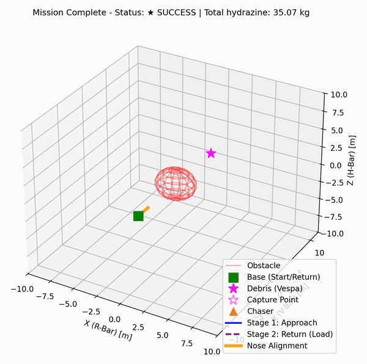
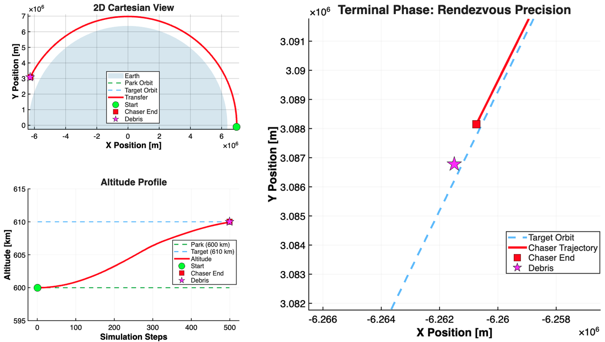
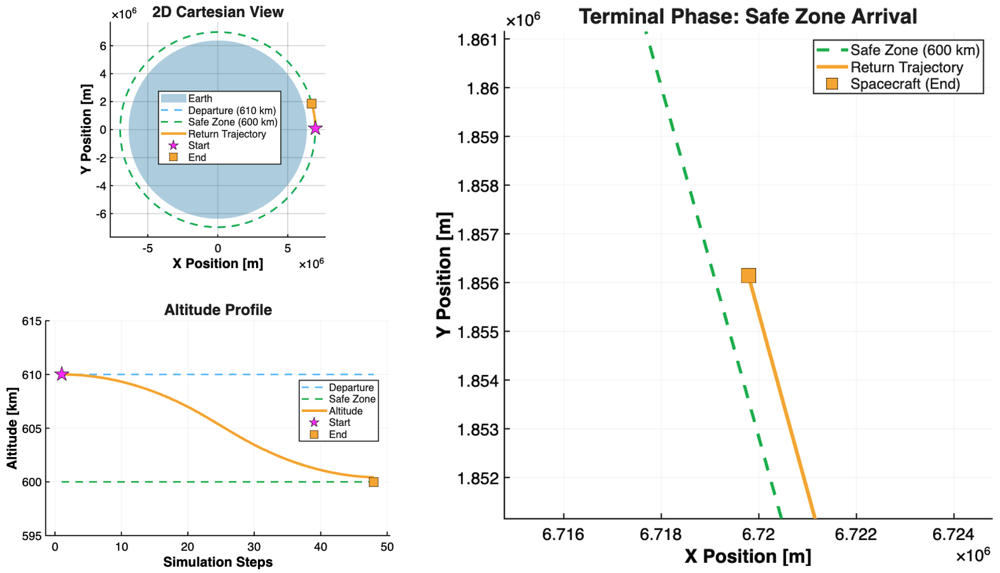

# 6-DOF Debris Capture & Orbit Transfer

**A 6-DOF Deep Reinforcement Learning Architecture for Autonomous Debris Capture and Orbit Transfer**

Deep-RL (PPO) guidance, navigation and control for a complete active-debris-removal mission in low Earth orbit: Hohmann transfer to the debris orbit, 6-DOF proximity operations and capture, and the return transfer to a safe disposal orbit with the debris attached. Published at IEEE/IFAC CoDIT 2026 ([IEEE Xplore](https://ieeexplore.ieee.org/document/11630811)).

<p align="center"></p>

## The mission

| Phase | What happens | Script |
|---|---|---|
| **0 · Far rendezvous** | Hohmann transfer from a 600 km parking orbit up to the debris orbit, ending next to the target | `code/Phase0.py` |
| **1 · Approach** | 6-DOF approach in the LVLH frame around a keep-out zone to the capture point, with the nose pointed at the debris | `code/Phase12.py` |
| **2 · Capture and return** | The debris mass and inertia are added to the chaser at capture (Huygens-Steiner), and the loaded chaser flies back to the base point | `code/Phase12.py` |
| **3 · De-orbit** | Retrograde Hohmann transfer down to the 600 km safe zone with the debris attached | `code/Phase3.py` |

Phases 1 and 2 run in one episode: capture happens mid-episode with no reset, the debris mass and inertia are added on the spot, and the policy flies the loaded chaser back. Phase 1 starts from a perturbed handover (+0.5 m/s at 8 m from the target). Propellant is depleted with the Tsiolkovsky equation in every phase, and in the Phases 1-2 environment the two transfers are propagated analytically around the learned segment.

## Approach

| | |
|---|---|
| **Algorithm** | Proximal Policy Optimization (Stable-Baselines3), one policy per mission segment: MlpPolicy [128, 128] for the transfers, [256, 256] for proximity operations; curriculum learning on the arrival tolerances |
| **Simulator** | Custom Gymnasium environments: Keplerian dynamics in ECI integrated with RK4, LVLH relative frame for proximity operations, quaternion attitude kinematics, Tsiolkovsky mass depletion |
| **Orbital transfers (0, 3)** | Phase 0: prograde / coast / retrograde burns; Phase 3: continuous 3-axis thrust. The reward is built on orbital energy (semi-major axis and eccentricity) rather than on distance to the target |
| **Proximity and capture (1, 2)** | Coupled 6-DOF bang-bang commands (three force and three torque axes, each −/0/+), milestone rewards at capture, fuel penalty tied to the physical Δv |

<p align="center"></p>
<p align="center"><sub>Phase 0: the outbound Hohmann transfer (left) and the terminal rendezvous next to the debris (right).</sub></p>

<p align="center"></p>
<p align="center"><sub>Phase 3: the retrograde return transfer (left) and the arrival in the 600 km safe zone (right).</sub></p>

## Results

| Metric | Value |
|---|---|
| Mission segments and PPO policies | 4 phases, 3 policies (Phase 0, Phases 1-2, Phase 3) |
| Actor inference time per control step | 0.18 ms (`code/inference_timing.py`) |
| Inertia jump absorbed at capture | +400 kg·m², with no retuning |
| Collisions over the full mission | 0 |

- The policy discovered the two-burn Hohmann transfer on its own, with no burn timing programmed in.
- The energy-based reward removed the stagnation that a plain distance-to-target reward caused during the transfers.
- At about 0.18 ms per step the controller is roughly two orders of magnitude faster than typical NMPC solvers.

## Repository layout

```
code/
  Phase0.py             Phase 0 environment, training and MATLAB export
  Phase12.py            Phases 1-2 environment (approach, capture, return), training and GIF rollout
  Phase3.py             Phase 3 environment (de-orbit), training and MATLAB export
  inference_timing.py   measures the PPO actor's inference time per step
  plotp0.m              MATLAB figures for Phase 0
  plot12.m              MATLAB figures for Phases 1-2
  plotp3.m              MATLAB figures for Phase 3
media/                  GIF and figures used above
```

## Running it

```bash
pip install -r requirements.txt
cd code
python Phase0.py      # or Phase12.py / Phase3.py
```

Each script holds two entry points for the curriculum: training from scratch, and resuming from the latest checkpoint for the next, tighter tolerance step (the one not in use is kept as a commented block). Checkpoints are written to `phase0_checkpoints/`, `adr_checkpoints/` and `phase3_checkpoints/`. After training, each script runs a deterministic test rollout and exports the trajectory to a `.mat` file (`phase0_orbits<tol>.mat`, `phase1_2_orbits.mat`, `phase3_curriculum_step<tol>.mat`); set the same file name at the top of the matching MATLAB script (`plotp0.m`, `plot12.m`, `plotp3.m`) to plot it.

## Context

Sapienza University of Rome, 2026. Paper presented at IEEE/IFAC CoDIT 2026 (Bari, Italy): [IEEE Xplore](https://ieeexplore.ieee.org/document/11630811).

**Author:** Federico Falconi · [LinkedIn](https://www.linkedin.com/in/federico-falconi/)
